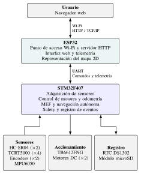
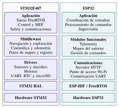
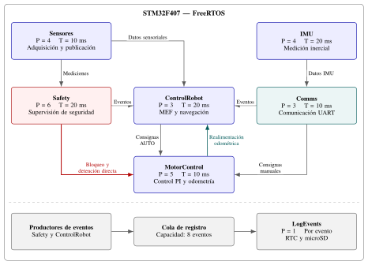
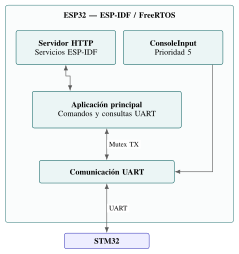
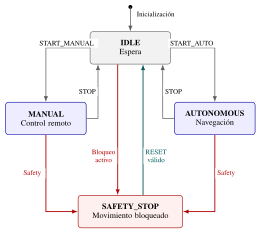

# Arquitectura de GenericAutonomousRobot

Referencia del firmware consolidado en `Grupo-1`, commit `132dcbb`. Los documentos de cada etapa conservan los parámetros y resultados de su momento.

## Responsabilidades

Los diagramas de esta página proceden del informe académico. El texto y las tablas detallan la implementación vigente.

La **STM32F407** adquiere los sensores, estima la pose, arbitra los modos, ejecuta Safety y aplica consignas a los motores. La **ESP32 clásica** gestiona el enlace UART, el punto de acceso, la API HTTP y el mapa. El navegador solicita operaciones y muestra telemetría.

## Arquitectura de software

En el bloque de cinemática y odometría, la estimación operativa corresponde a `mid_odometry`. `Kinematics_Compute()` es un esqueleto sin uso.

## Tareas y sincronización en STM32

El scheduler usa ticks de 1 ms. La tabla enumera las siete tareas de aplicación, aparte de las tareas del kernel. Los tiempos son nominales y las prioridades son relativas a `tskIDLE_PRIORITY`.

| Tarea | Prioridad | Activación | Responsabilidad e interacción |
|---|---:|---|---|
| Safety | +6 | 20 ms | Evalúa sensores y fallas enclavadas, detiene MotorControl y avisa a la FSM. |
| MotorControl | +5 | 10 ms | Lee TIM1/TIM2 en modo encoder, actualiza odometría y ejecuta el PI de velocidad. Revalida las consignas antes de aplicar dirección y PWM por TIM4. |
| Sensores | +4 | Base de 10 ms | Lee IR cada 20 ms, alterna ultrasónicos y publica la última instantánea para Safety, navegación y telemetría. |
| IMU | +4 | 20 ms | Lee el MPU6050 y publica estado, muestras, calibración y estimaciones angulares de diagnóstico. |
| ControlRobot | +3 | 20 ms | Consume eventos, ejecuta la FSM principal y llama a navegación en AUTO. |
| Comms | +3 | 10 ms | Recibe tramas UART, solicita eventos y consignas, y responde consultas con datos ya adquiridos. |
| LogEvents | +1 | Espera bloqueante en cola | Consume eventos y los persiste en CSV cuando el volumen está disponible. |

ControlRobot tiene una cola de ocho eventos. Sensores, IMU y MotorControl usan colas de un elemento para la última instantánea o consigna. Los consumidores de sensores e IMU copian la última instantánea sin retirarla. El logger tiene su propia cola estática de ocho eventos y una tarea creada con stack estático de 512 palabras.

La ISR de USART2 ensambla tramas en un buzón con prioridad y conserva el tick del primer byte. TIM3 y DMA1 completan las capturas ultrasónicas por interrupción. Se usan secciones críticas para proteger estados compartidos y se aíslan las IRQ de DMA durante operaciones sobre sus capturas. El logger serializa accesos a RTC y FatFs con un mutex compartido.

## Tareas y servicios en ESP32

`app_main()` despacha órdenes, agenda consultas y concentra la recepción UART. La consola lee la entrada serie en su propia tarea. HTTP obtiene copias de la telemetría y deja las solicitudes de mando para su despacho. La transmisión UART se serializa con un mutex.

## UART y arranque

| Placa | Periférico | TX | RX |
|---|---|---|---|
| STM32 | USART2 | PA2 | PA3 |
| ESP32 | UART2 | GPIO17 | GPIO16 |

El protocolo usa texto ASCII a 115200 baudios, 8N1 y líneas con LF. El receptor STM32 también admite CRLF. STOP tiene prioridad sobre DETENER y el tráfico ordinario. `STATUS` responde `STATE=<n> FAULTS=<máscara> STOP=<0|1>`. Las consultas de sensores, mapa, IMU, navegación y exploración reutilizan este enlace.

En `main.c` se inicializa el periférico y se llama a `DrvUart_Init()`. El mensaje de arranque indica que TX puede transmitir. Después de inicializar RTC/logger y crear las tareas, se inicia el scheduler. **`TaskComms_Run()` llama a `DrvUart_StartReceive()`**, de modo que la ISR puede usar `xTaskGetTickCountFromISR()` con FreeRTOS en marcha. La prioridad NVIC de USART2 es 5, compatible con el límite de llamadas al kernel desde ISR. Una falla de `DS1302_Init()` detiene el arranque antes del scheduler.

## FSM, Safety y navegación

La figura resume transiciones. MANUAL y AUTO requieren que Safety permita el movimiento. STOP en SAFETY_STOP mantiene ese estado y el arranque puede pasar de IDLE a SAFETY_STOP por el bloqueo inicial.

| Estado | Código | Comportamiento |
|---|---:|---|
| IDLE | 0 | Espera una solicitud válida de MANUAL o AUTO. |
| AUTONOMOUS | 1 | Ejecuta el perfil autorizado. Una sesión terminal puede quedar en AUTO con los motores detenidos hasta STOP. |
| MANUAL | 2 | Acepta consignas manuales vigentes. DETENER cancela el movimiento manual. |
| SAFETY_STOP | 3 | Mantiene el bloqueo y admite rearme explícito si las comprobaciones lo permiten. |

Safety supervisa los cuatro IR, la validez y la edad de los ultrasonidos, y la publicación de sensores. Una indicación de ausencia de piso, un eco inválido o antiguo, o una distancia válida de **200 mm o menos** pueden disparar stop y fallas enclavadas. Los plazos de Safety son 100 ms para la publicación de sensores y 200 ms para los ecos individuales. La recuperación de una lectura no borra el enclavamiento. RESET solicita un rearme que vuelve a comprobar las condiciones. STOP cancela movimiento y navegación, sin despejar fallas enclavadas. MotorControl verifica modo, autorización y vigencia, con un timeout de consignas de 500 ms.

`AUTO` conserva AUTO-2F como perfil de comando. `AUTO_TURN`, `AUTO_EVADE` y `AUTO_CONTINUOUS` seleccionan ensayos explícitos. El panel destaca `AUTO_EXPLORE`, que inicia **LOCAL_EXPLORE** desde IDLE bajo supervisión presencial:

- Prioriza tramos frontales de 50 mm con evidencia reciente y margen suficiente. El criterio frontal del explorador es 350 mm y el umbral preventivo de navegación es 275 mm.
- Ante un bloqueo, estabiliza, evalúa sectores angulares y considera giros acotados y retiradas de 20 mm con lectura trasera válida superior a 250 mm. Revalida Safety, progreso y odometría durante las maniobras. Los ecos ausentes no aportan evidencia de espacio libre.
- Conserva memoria de posiciones para evitar ciclos y reconsidera alternativas con información nueva. Las maniobras tienen límites propios. Si no encuentra una opción admisible, mantiene los motores detenidos.
- La autorización se concede una vez por sesión. El watchdog STM32 de 3000 ms comprueba el ida y vuelta del enlace con ESP32. Cerrar el navegador puede dejar el robot en marcha mientras ese enlace continúe operativo. Una sesión cancelada o terminal exige un inicio nuevo.

El mapa web no interviene en la autorización de maniobras. Los ultrasonidos frontal y trasero no observan toda la envolvente lateral de un giro. [Detalle de LOCAL_EXPLORE](Pruebas/EXPLORACION_LOCAL_SUPERVISADA.md).

## Sensores y estimación

Los cuatro TCRT5000 se leen como entradas digitales. Cualquiera que indique ausencia de piso activa el indicador de caída. Los HC-SR04 comparten TIM3, reservado para esta adquisición:

| Sensor | TRIG | ECHO | Captura | DMA |
|---|---|---|---|---|
| Frontal | PC9 | PC6 | TIM3 CH1, AF2 | DMA1 Stream 4, canal 5 |
| Trasero | PC5 | PC8 | TIM3 CH3, AF2 | DMA1 Stream 7, canal 5 |

El driver arma DMA **antes** del pulso TRIG de 10 µs generado con GPIO y DWT. `HCSR04_Trigger()` y `HCSR04_Rear_Trigger()` devuelven `HAL_StatusTypeDef`. Una falla de armado impide disparar. TIM3 captura ambos flancos con tick de 1 µs (`PSC=83`, `ARR=0xFFFF`). DMA transfiere dos valores de 16 bits por captura. La distancia resulta del ancho del pulso, con corrección por desbordamiento, multiplicado por 340 m/s y dividido por dos.

TaskSensores alterna disparos con separación mínima de 70 ms y resuelve cada intento en una ventana de 50 ms. Cancela la captura al concluir y no inicia la siguiente si el cierre falla. Acepta distancias entre 0,02 y 4 m como rango de software. El alcance físico depende del montaje y del entorno. Se conservan por separado la disponibilidad, la validez y los ticks del intento resuelto y de la última captura válida. Las consultas UART no generan disparos.

La odometría diferencial integra las cuentas de ambas ruedas con diámetros de 25,4 mm, base de 149,2 mm y CPR efectivos configurados de 1435,2 y 1421,6 para izquierda y derecha. La configuración es **provisional**. El historial de poses permite asociar ecos con el instante de adquisición. La estimación relativa acumula error por deslizamiento y sesgos geométricos.

El MPU6050 usa **I²C1, PB6/SCL y PB9/SDA**. La calibración manual del giróscopo toma 250 muestras con el robot inmóvil y conserva los offsets en RAM. La integración de giro Z y la fusión complementaria con encoders se publican como diagnósticos. No gobiernan motores, odometría ni mapa.

## Interfaz y mapa

La ESP32 ofrece SoftAP WPA2-PSK y un servidor HTTP local con purga LRU de sesiones. El AP usa el SSID `GenericRobot`, canal 1, DHCP y hasta dos clientes. La clave de laboratorio está en [wifi_ap.c](../Firmware/esp32_gateway/src/wifi_ap.c) y la consola informa la IP del AP, normalmente `192.168.4.1`. El AP y el servidor se intentan iniciar una vez por arranque. El panel reúne exploración, STOP, rearme, control manual de pulsación sostenida, sensores y calibración manual del giroscopio.

Los recursos web se embeben mediante [PlatformIO](../Firmware/esp32_gateway/platformio.ini) y [CMake](../Firmware/esp32_gateway/src/CMakeLists.txt). El servidor usa las longitudes de los recursos embebidos y prescinde de una partición de sistema de archivos.

`/health` comprueba el servidor ESP32. `/api/sensors`, `/api/imu`, `/api/map`, `/api/navigation` y `/api/exploration` exponen sus diagnósticos. `GET /api/status` informa el último STATUS válido de STM32:

- `valid` indica que se recibió al menos un STATUS válido. `connected` exige que tenga menos de 3000 ms. La consulta UART se programa cada 1000 ms nominales.
- `state`, `faults`, `stop` y `age_ms` son `null` antes de la primera respuesta válida. Al vencer la vigencia se conserva el último estado como dato histórico. La máscara usa 1 para caída, 2 para obstáculo, 4 para sensor y 8 para emergencia.
- `stop` refleja el bloqueo consultado en Safety. `age_ms` mide desde la recepción en ESP32. STATUS carece de identificador de consulta y STM32 lee sus campos por separado.

`POST /api/command` admite nombres exactos de comandos, exige `Content-Type: text/plain`, `Origin` igual a `http://<Host>` y un `X-Request-ID` de 32 caracteres hexadecimales minúsculos. Ese identificador permite deduplicar dentro de un historial volátil y acotado. STOP puede reemplazar una orden pendiente de despacho. HTTP 202 confirma aceptación por ESP32. El comprobante distingue transmisión UART y observación posterior por STATUS, que por sí sola no prueba causalidad ni movimiento. El diseño del panel y su verificación están en la [guía del dashboard](../Firmware/esp32_gateway/Tests/w2/README_dashboard.md).

El mapa en ESP32 combina poses y ecos válidos en una grilla de **80×80 celdas de 50 mm**, con zonas desconocidas, libres observadas y de ocupación posible. Usa una trayectoria acotada y representa la incertidumbre de los ecos. Zoom, centrado y visibilidad de la capa de ocupación afectan solo la vista. El panel señala pose inválida, datos históricos y geometría provisional. Es un mapa relativo de diagnóstico, sin SLAM, corrección de deriva ni cobertura garantizada.

## Registro y estado de validación

`Log_EventPublish()` encola eventos sin esperar espacio ni realizar E/S. Los productores operativos registran arranque, transiciones, fallas nuevas, rearme y STOP. `LogEvents` consume la cola, obtiene la hora del DS1302 y escribe y sincroniza `0:/EVENTOS.CSV`. Conserva el tick original del evento y deja la fecha vacía si la lectura del calendario es inválida.

`Log_Write()` es la vía síncrona separada hacia `0:/GAR.LOG` cuando está disponible y hacia USB CDC con el puerto abierto. La microSD usa SPI y FatFs. Si falla la persistencia CSV de forma no recuperable, se deshabilita esa escritura hasta reiniciar y el consumidor sigue drenando la cola. No hay contador automático de eventos perdidos. [Contrato de códigos](CODIGOS_EVENTOS.md).

Se realizaron ensayos físicos previos de movimiento, encoders, navegación supervisada y uso del panel. También se comprobó en una etapa anterior la escritura del CSV en microSD. Los inconvenientes recientes del módulo SD requieren repetir esa comprobación. La geometría sigue identificada como provisional y las zonas de ocupación posible no certifican obstáculos ni espacio libre.
